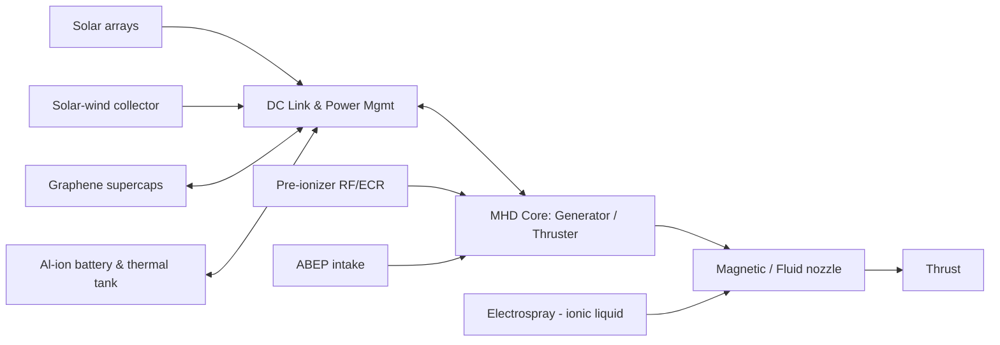

# Overby Industries: Magnetohydrodynamic Ionic-Liquid Generator & Dual-Mode Propulsion

### Version 0.1 — Draft for Community Review

**Author:** Overby Industries R&D Division

---

## Abstract

This paper lays out the physics basis and first-order engineering sizing for the Overby Industries power-and-propulsion core: a magnetohydrodynamic (MHD) channel that operates in two modes — as a generator that harvests electrical power from a flowing conductive plasma, and as a Lorentz-force accelerator that uses the same hardware to produce thrust. It is paired with dual-mode ion propulsion (Air-Breathing Electric Propulsion in atmosphere, electrospray of ionic liquids in vacuum) and a solar-wind collector for continuous trickle charging. This document is deliberately conservative: every number given is a benchtop-scale target or an order-of-magnitude estimate, not a performance claim for a flight system. The companion repository, [`power-and-propulsion`](https://github.com/Overby-Industries/power-and-propulsion), implements these equations as a small C++ sizing library and a finite-state-machine control architecture for the flight/embedded side.

---

## 1. Why One Core Does Two Jobs

A conductive fluid (plasma, or vapor from an ionic liquid) moving through a magnetic field experiences a motional EMF. Run current out of that field through electrodes, and you have a generator. Reverse the sign — push current *into* the channel instead of taking it out — and the same `J × B` force that resisted the flow now accelerates it. That's the whole idea: one duct, one set of coils, two modes, switched electronically rather than mechanically.

- **Generator mode:** captured solar wind plasma or seeded ionic-liquid vapor flows through the channel; Faraday/Hall electrodes pull current into a DC bus that charges graphene supercapacitors and an aluminum-ion battery/thermal tank.
- **Thruster mode:** the DC bus drives current back through the channel; the resulting Lorentz body force accelerates the working fluid out a magnetic/fluid nozzle for thrust.

## 2. Operating Medium

- **Working fluids:** seeded noble gas (Ar/Xe/Kr), or vaporized ionic-liquid fragments (e.g. EMIM-BF4, or EMIM-AlCl4 from an AlCl3–EMIMCl eutectic). Small alkali seed fractions (K/Cs) raise plasma conductivity.
- **Benchtop targets:** electron density n_e ~ 10^17–10^19 m^-3, electron temperature T_e ~ 1–5 eV, plasma conductivity σ ~ 10^2–10^3 S/m (higher with seeding/heating).
- **Magnetic field:** B ~ 0.5–3 T. Copper coils for early prototypes; REBCO high-temperature-superconducting tape at 20–40 K for later stages, to hit 1–5 T with lower I²R loss.
- **Channel scale:** height 1–5 cm, width 5–15 cm, length 20–80 cm for a benchtop core.

## 3. Creating the Plasma

- **RF helicon or ECR stage:** couples RF/microwave power into a neutral gas flow inside a short quartz/Al₂O₃ tube. A modest solenoidal field (0.05–0.2 T) improves coupling and uniformity.
- **Alternative:** DC arc or pulsed inductive discharge for high-conductivity bursts feeding the MHD duct.
- Gas handling runs closed-loop with a condenser for ionic-liquid vapor recovery, and a getter bed to scrub oxygen/water when running in ABEP (air-breathing) mode.

## 4. Generator Mode — The Physics

For a conductive fluid with bulk velocity **v** through a transverse field **B**, the motional EMF is

  **E_ind = v × B**  (Faraday's law)

and the current density in the channel, including the Hall term, is

  **J = σ (E + v × B − (1/n_e e) J × B)**

The last term is the Hall effect: it deflects current sideways in the channel and has to be designed around, not ignored. Net extracted power is `P = ∫ J·E dV`.

Two electrode topologies:

- **Faraday generator:** continuous electrodes span the duct height and collect the EMF directly. Needs Hall short-circuit mitigation — insulating sidewalls or guard electrodes — or the Hall current just shorts itself out along the wall.
- **Hall generator:** short, segmented electrode pairs alternate along the flow direction, aligned with the Hall field. Easier current control at high Hall parameter.

### Non-dimensional design groups

These three numbers are what you actually use to pick channel length, field strength, and flow velocity — not the raw equations above:

| Group | Definition | Target | What it tells you |
|---|---|---|---|
| Hartmann number | Ha = B·L·√(σ/μ) | Ha ≫ 1 | How strongly the field dominates viscous flow — you want this high for real MHD control authority. |
| Interaction parameter | N = σ·B²·L / (ρ·v) | N ~ 1–10 | Efficiency of energy conversion without choking the flow — too low and you're not extracting much; too high and you stall the channel. |
| Magnetic Reynolds number | Rm = μ₀·σ·v·L | Rm ≪ 1 | Whether you can treat B as externally imposed (simpler control) or need to account for the plasma's own induced field. |

(μ is dynamic viscosity, μ₀ the permeability of free space, ρ the fluid density, L the channel length.)

### Electrode hardware

Graphite/SiC-coated electrodes, or liquid-metal (GaInSn) electrodes for higher current density (1–20 A/cm²) with less erosion. Output is rectified into the DC link feeding the supercapacitor and battery bus.

## 5. Thruster Mode — Switching to Accelerate

Reconfigure the power electronics so the DC link drives current *into* the duct instead of pulling it out. The body force density on the plasma is

  **f = J × B**

which accelerates the fluid axially out the channel. A magnetic or fluid nozzle then expands it:

- Electrothermal + MHD hybrid: throat-to-exit area ratio 1:3–1:7.
- Pure Lorentz acceleration: shape the magnetic nozzle's field gradient (dB/dz) to minimize plasma detachment losses at the exit.

### Dual-mode intake paths feeding the same channel

- **ABEP (Air-Breathing Electric Propulsion):** an intake scoop and pre-ionizer harvest residual atmosphere in LEO/VLEO. The MHD channel runs in accelerator mode to overcome intake drag and ionization losses.
- **Electrospray:** porous/needle emitters draw from ionic-liquid tanks (EMI-BF4, EMI-AlCl4), producing droplet/ion beams. Supercapacitor pulses handle beam neutralization and short thrust spikes, or feed seed mass into the MHD accelerator.

## 6. Solar Wind Capture — What It's Actually Good For

An electrostatic or mini-magnetospheric collector slows incoming charged particles, doing work on the collector. At 1 AU, realistic solar wind parameters are n ≈ 3–10 particles/cm³, v ≈ 400 km/s, giving a dynamic pressure of roughly 1–3 nPa. That works out to available power densities in the **nanowatt-to-microwatt per square meter** range unless the collector area is very large.

This is worth stating plainly: solar wind capture is a slow, continuous trickle-charge source for the bus, not primary propulsion power and not a source of "free" or "near-infinite" delta-V. It supplements the battery/supercapacitor bank between active burns; it does not replace them.

## 7. Thermal and Structural Integration

- **Ionic-liquid tanks double as thermal mass.** Hot dielectric coolant loops through battery jackets; the high heat capacity (and in some formulations, phase-change behavior) of ionic liquids buffers pulse loads on the order of 10–50 kJ/kg.
- **Magnets:** copper for early benchtop prototypes; REBCO HTS tape at 20–40 K for later stages.
- **Structural liner:** SiC or Si₃N₄. **Insulating coatings:** YSZ or BN.

## 8. System Architecture

```
 [Solar Arrays]        [Solar Wind Collector]
       |                        |
       v                        v
 +---------------------------------+
 |     DC Link / Power Mgmt        |<---->[Graphene Supercapacitors]
 |     (MPPT, rectifiers)          |<---->[Al-ion Battery / Thermal Tank]
 +---------------------------------+
       ^                        |
       |  (bidirectional)       v
 +-----------------------------------+
 |            MHD Core                |<-- Pre-ionizer (RF/ECR/Arc)
 |  Mode A: Generator  --> DC Link    |
 |  Mode B: Thruster   <-- DC Link    |
 +-----------------------------------+
                  |
          Magnetic / Fluid Nozzle
                  |
      +-----------+------------------+
      | ABEP Inlet (LEO/VLEO)        |  Electrospray Emitter (ionic-liquid)
      +-----------+------------------+
                  v
                Thrust
```



This is the same architecture diagrammed in the [organization README](https://github.com/Overby-Industries) and implemented in code in the [`power-and-propulsion`](https://github.com/Overby-Industries/power-and-propulsion) repository — this paper is the physics reference the code implements against, not a separate parallel design.

## 9. Testing Roadmap

| Phase | Focus | Deliverable |
|---|---|---|
| I — Simulation | Python/MATLAB or the C++ sizing models in `power-and-propulsion/sim` validate the non-dimensional groups against target channel geometry before any hardware is cut. | Validated parameter envelope (B, L, v, σ) for a benchtop core. |
| II — Benchtop | Ionic-liquid/plasma vortex chamber at low power; measure achieved σ, Ha, N against simulation. | Benchtop MHD generator demonstrating net positive electrical extraction. |
| III — Vacuum chamber | Full accelerator-mode test in a vacuum chamber; measure thrust, specific impulse, and mode-switching transient behavior. | Characterized thrust curve and switching latency. |
| IV — CubeSat demo | Unmanned orbital demonstrator combining generator trickle-charge, ABEP intake, and electrospray thrust. | On-orbit validation of dual-mode operation. |

## 10. Conclusion

None of the individual pieces here are new physics — MHD generators, Hall thrusters, electrospray propulsion, and solar wind collection are each independently studied and, in several cases, flight-proven in isolation (see the companion [organization README](https://github.com/Overby-Industries) for the point-by-point comparison against NASA/ESA precedent). What Overby Industries is proposing is the integration: one channel, one set of coils, switched between generation and thrust, so the same hardware mass does two jobs across a mission profile instead of one. This paper — and the `power-and-propulsion` codebase it's paired with — exists so that integration can be reviewed, criticized, and improved in the open before any hardware gets built.

## References

[1] Sutton, G. W., & Sherman, A. *Engineering Magnetohydrodynamics.* McGraw-Hill, 1965. (Standard reference for the Hartmann number, interaction parameter, and Faraday/Hall generator topologies used in Section 4.)
[2] Janhunen, P. "Electric sail for spacecraft propulsion." *Journal of Propulsion and Power*, 2004.
[3] NASA Innovative Advanced Concepts (NIAC) — Magnetosail / Electric Sail studies.
[4] Placeholder for additional academic references — open for community submission.
[5] Placeholder for community submissions.
